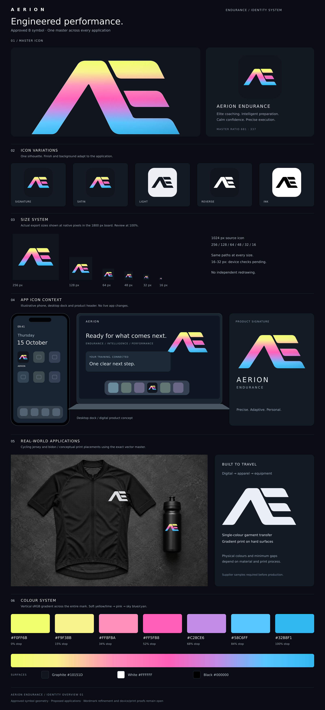

# AERION identity v1 — locked

Approved by Dennis Ariens on 15 October 2026 in AERION Work: “Excellent, lock it and push it to github”. Candidate B is the selected identity. This directory is the canonical brand package on this branch. Earlier concepts, rejected R1 geometry and exploratory renders are superseded.

## Locked identity

- Integrated AE: open A, rounded apex and inner transition, separated upper/middle E bars, extended lower right foot.
- One master geometry for every colour, size and application; do not independently redraw variants.
- Soft yellow/lime at top, pink through middle, sky blue/cyan at bottom. Use the clean gradient for routine digital use and the satin finish for larger applications.
- Black and white single-colour versions for fabrication and contrast-sensitive contexts.
- Approved identity overview and proposed application direction are included as PNG, SVG and a self-contained HTML file.

`assets/AE-B-master-black.svg` is the canonical shape. `assets/AE-B-gradient.svg` is the everyday colour master. `assets/AE-B-satin.svg` adds clipped tonal modelling. All are editable vector paths; no bitmap tracing is embedded in these masters.

## Colour recipe

The gradient runs vertically across the entire symbol in sRGB, from y=135 to y=472 in the master viewBox `328 135 681 337`. Do not repeat the gradient independently on each E bar.

| Stop | HEX |
| --- | --- |
| 0% | #F0FF6B |
| 15% | #F9F38B |
| 34% | #FF8FBA |
| 52% | #FF5FB8 |
| 68% | #C28CE6 |
| 84% | #58C6FF |
| 100% | #32B8F1 |

Icon surface: #10151D. Mono: #000000 / #FFFFFF. Exact tokens are in `assets/gradient-tokens.json`. Satin adds a diagonal white 12%-to-clear-to-dark-blue 12% overlay and a clipped 1.8-unit white highlight at 38% opacity. These are the accepted reconstructed colours, not a calibrated recovery of the original AI render.

This identity palette does not automatically replace semantic UI colours in the root BRAND.md contract.

## Asset inventory

- SVG masters: black, white, gradient and satin.
- Transparent 2048 px PNGs plus a 4096 × 2027 satin PNG.
- RGB vector PDF interchange files: gradient and black.
- Outlined AERION wordmark and stacked lockup, retained as current supporting artwork; final typography refinement remains open as noted in the approved overview.
- Square icon exports: 16, 32, 48, 64, 128, 256, 512 and 1024 px, plus ICO and ICNS containers.
- SHA-256 file inventory in `manifest.json`; export checks in `assets/validation.json`.

## Rules and release boundaries

Preserve aspect ratio 681:337. Preserve path positions and bar relationships. Initial suggested clear space is 15% of symbol height; final minimum sizes remain subject to testing. All changes to locked geometry or gradient require owner approval and a new version; do not silently overwrite this v1 package.

The 16–32 px icons need real-device inspection. Merchandise imagery is a conceptual mockup using generated product photography and exact vector placements. Supplier-specific print, embroidery, vinyl and engraving proofs are required. RGB PDFs are not universal CMYK or press-certified files.

Approval locks the identity and authorizes this GitHub push. It does **not** authorize replacing the app icon, changing Electron packaging, modifying live product UI, merging this branch, or deploying. No source, app configuration, coaching logic or athlete data is changed by this package.
